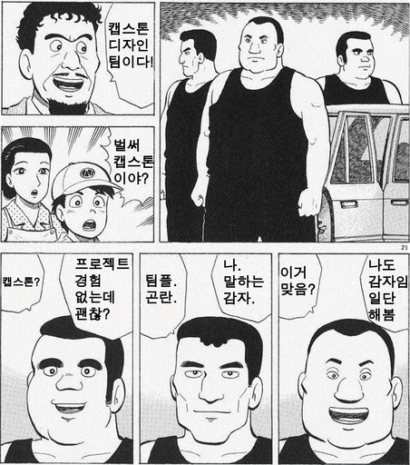

    
    

    
 
    <h2 style="border-bottom: 1px solid #d8dee4; color: #282d33;"> All coders end up making fried chicken! </h2>  
    
 We're gathering members who will work with us making fried chicken! Freely contact to us: oh_my_gotto_its_chicken@cau.ac.kr 
 
    

    

    <h2 style="border-bottom: 1px solid #d8dee4; color: #282d33;"> 🛠️ Tech Stacks </h2>   
    
 
          
          
          
          
           

    

    <h2 style="border-bottom: 1px solid #d8dee4; color: #282d33;"> 🐔 Run. </h2>   
          
    

    

