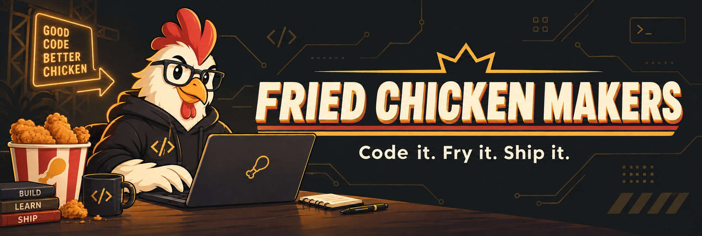

<p align="center">
  
</p>

<p align="center">
  <strong><h2>TEAM 치킨집창업희망</h2></strong><br />
  A student developer team cooking bold ideas into working products.
</p>

<p align="center">
  <a href="https://github.com/FriedChickenMakers/CapstoneDesign2026">
    
  </a>
  
</p>

---

## 🍗 About Us

Hello, there!

We are **Fried Chicken Makers**.

We are student developer team developing fascinating ideas into real-product!

*This project is **Chung-Ang University CSE Capstone Design(1)** project.*

> **Code it. Fry it. Ship it.**  
> Make ideas to product. *Who knows? To be a developer, or fried chicken maker.*

---

## 🚀 Current Project

### Capstone Design 2026 - 마음의 정원

This repo is for Capstone Design project.

Currently on developing.

<p>
  <a href="https://github.com/FriedChickenMakers/CapstoneDesign2026">
    
  </a>
</p>

| Item | Item |
|---|---|
| Project | Capstone Design 2026 |
| Organization | Chung-Ang University CSE |
| Progress | on developing |
| Goal | on developing ~~*Making perfect fried chicken? idk;*~~|
| Docs | on developing |

---

## 🧰 Tech Kitchen

Our project's tech stacks.

### Client

  

### Collaboration

  

---

## 🔥 How We Work

```text
IDEA  →  DESIGN  →  BUILD  →  TEST  →  SHIP
```

- Any idea is fine! ~~*Let's make fried chicken*~~
- Documentation is also important. ~~*because of our poor memory*~~
- Goal-Oriented.
- We adopted **Kanban** workflow system!
- We share our challenges and failures as a team experience.

---

## 👥 Team

<table>
  <tr>
    <td align="center">
      <a href="https://github.com/StraySpeed">
        <br />
        <sub><b>@StraySpeed</b></sub>
      </a><br />
      <sub>Project Lead</sub>
    </td>
    <td align="center">
      <a href="https://github.com/DeepMatcha">
        <br />
        <sub><b>@DeepMatcha</b></sub>
      </a><br />
      <sub>Client Developer</sub>
    </td>
    <td align="center">
      <a href="https://github.com/mintchokim">
        <br />
        <sub><b>@mintchokim</b></sub>
      </a><br />
      <sub>Game Designer</sub>
    </td>
  </tr>
</table>


---

## 📫 Contact

We're gathering members who will work with us making fried chicken!

Freely contact to us: **oh_my_gotto_its_chicken@cau.ac.kr**

<p align="center">
  <sub>
    Made with code, collaboration, and a suspicious amount of fried chicken. 🍗
  </sub>
</p>
